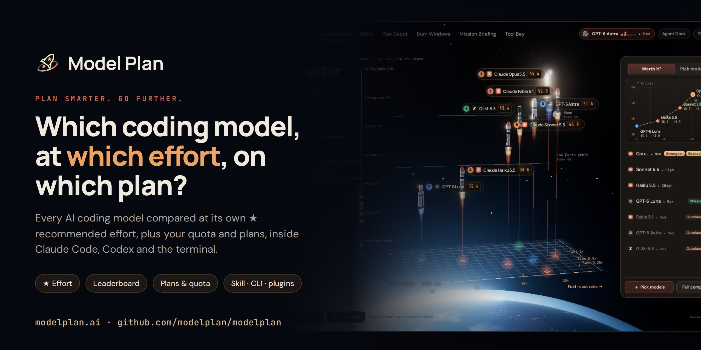
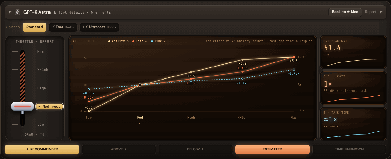
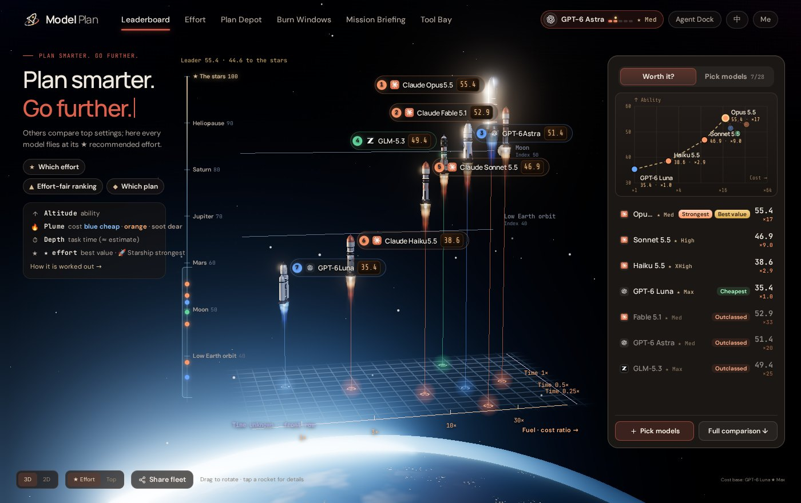
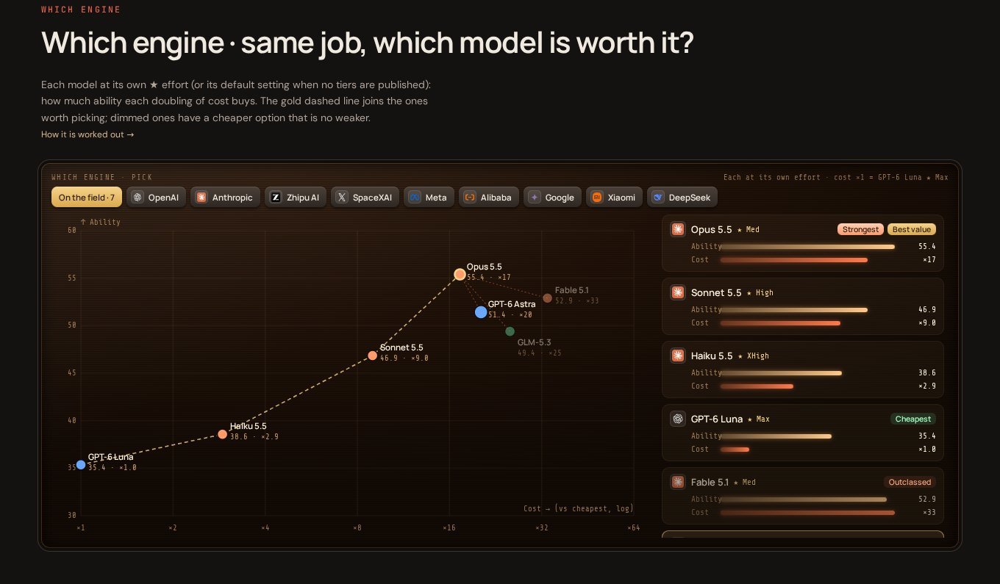
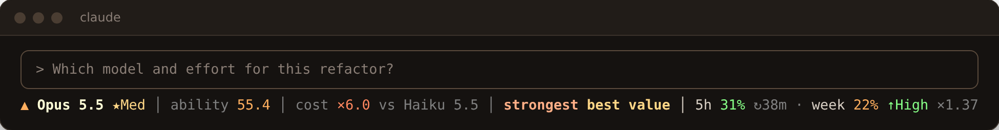
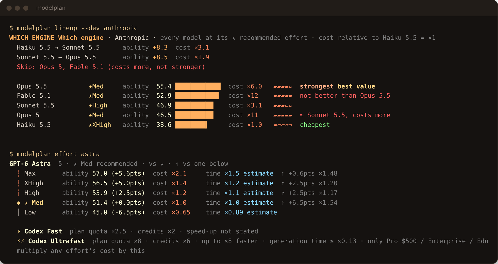
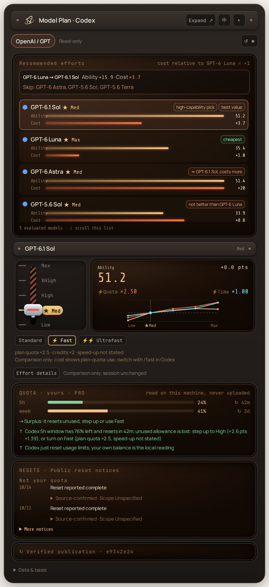
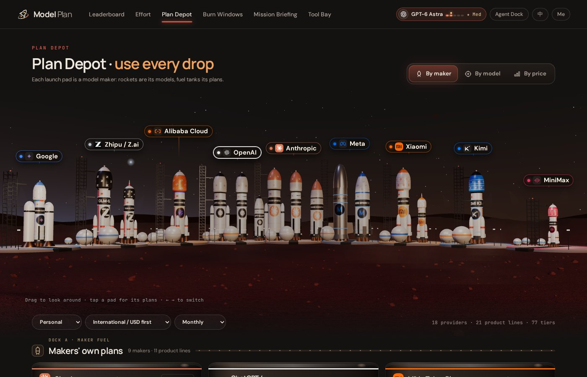
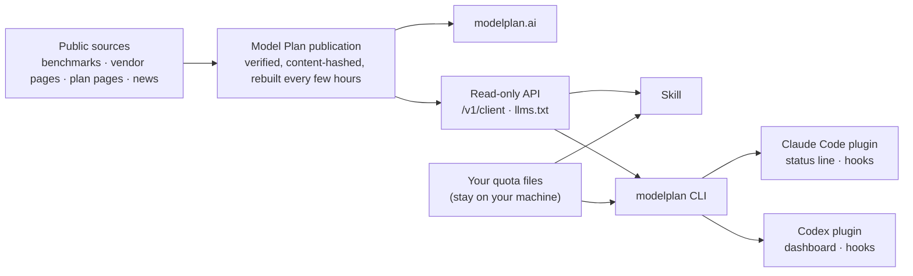

<div align="center">

<a href="https://modelplan.ai"></a>

**Which AI coding model should you use, at which reasoning effort, and is one more step up worth it?**<br>
Model Plan answers from live, checkable public data, on the web and inside Claude Code, Codex and your terminal.

[](https://github.com/modelplan/modelplan/releases)
[](https://github.com/modelplan/modelplan/actions/workflows/ci.yml)
[](LICENSE)
[](https://modelplan.ai)
[](https://github.com/modelplan/modelplan/stargazers)

[Website](https://modelplan.ai) · [Quick start](#quick-start) · [Screenshots](#what-you-get) · [How it works](#how-it-works) · [FAQ](#faq) · [Methodology](METHODOLOGY.md) · [简体中文](README.zh-CN.md)

</div>

## Why Model Plan

Most leaderboards compare every model at its **top** setting. But inside one model, going from Low to Max often costs several times more and takes several times longer, for a few points of ability. What you actually run is a model *at an effort*.

- **★ Recommended effort.** Every model gets its best-value effort, and you see exactly what one more step up buys (`+4.8 ability`) and costs (`×1.37`).
- **A leaderboard at that effort.** Models are ranked at their own ★ effort, the setup you would really use, with cost per reference coding task and task time beside ability. Outclassed models (costlier and no stronger) are called out.
- **Your own quota.** The Skill and CLI read your local Claude Code and Codex 5-hour and weekly windows (never uploaded). Plenty left before a reset? Step up, or turn on Codex Fast. Tight? Stay at ★ or step down. After a reset, it reminds you to switch back.
- **Plans and windows.** Coding plan prices and quotas by maker, model and price band; off-peak hours, peaks and public quota resets on a week calendar.
- **In your tools.** One open-source Skill for any agent, plugins for Claude Code and Codex, and a single-binary CLI, all reading the same verified publication as the website.

## Quick start

**The Skill** works in Claude Code, Codex, Cline, Amp and 15+ other agents:

```sh
npx skills add modelplan/modelplan
```

Then ask your agent: *"Which model and effort should I use for this refactor?"* or *"My 5-hour window resets in 40 minutes, should I step up?"*

<details>
<summary><b>Claude Code plugin</b>: the Skill, <code>/modelplan:*</code> commands and a status line</summary>

```text
/plugin marketplace add modelplan/modelplan
/plugin install modelplan@modelplan
```

Commands: `/modelplan:plan`, `/modelplan:effort`, `/modelplan:lineup`, and `/modelplan:statusline` to add the status line (asks before changing your settings). [More](claude-code/)

</details>

<details>
<summary><b>Codex plugin</b>: the Skill plus a GPT effort dashboard</summary>

```sh
codex plugin marketplace add modelplan/modelplan
codex plugin add modelplan-codex@modelplan
```

Ask Codex to *"Open the Model Plan dashboard"*. Requires Node.js 24+. [More](codex/)

</details>

<details>
<summary><b>modelplan CLI</b>: a single static binary for macOS, Linux and Windows</summary>

```sh
curl -fsSL https://raw.githubusercontent.com/modelplan/modelplan/main/install.sh | sh
modelplan lineup --dev anthropic
```

Windows: download from [Releases](https://github.com/modelplan/modelplan/releases). With Go: `go install github.com/modelplan/modelplan/cli/cmd/modelplan@latest`. The Skill and plugins use it when it is installed and work without it. [More](cli/)

</details>

<details>
<summary><b>Skill by hand</b></summary>

Copy [`skills/model-plan`](skills/model-plan/) into `~/.claude/skills/model-plan` or your agent's skills directory. It needs only a shell and anonymous HTTPS.

</details>

## What you get

### ★ The effort that is worth it, and what the next step costs

Move the throttle and see ability, cost and task time for every native effort; switch on ⚡ Fast or ⚡⚡ Ultrafast to see how plan quota and time change.



### A leaderboard at each model's recommended effort





### Advice that knows your quota, inside Claude Code and Codex

<table>
<tr>
<td width="56%" valign="top">

**Claude Code status line**: live model and effort, 5-hour and weekly usage, the reset countdown, and a hint when it is worth acting (`↑High ×1.37` before a reset with allowance left, `↓` when a window is tight, `↺★` after a reset).



**CLI**: lineups, effort ladders, quota and advice.



</td>
<td width="44%" valign="top">

**Codex dashboard**: GPT models at their ★ effort, the effort curves with a ⚡ switch, your Codex quota and public reset notices.



</td>
</tr>
</table>

### Coding plans, off-peak hours and resets



## Not just another leaderboard

| | Typical leaderboard | Model Plan |
| --- | --- | --- |
| Setting compared | each model's top setting | each model's ★ recommended effort, plus every other effort |
| Cost | price per million tokens | cost of one reference coding task, at every effort |
| Time | rarely | task time at every effort (estimates marked) |
| One step up | not shown | `+ability` and `×cost` for each step |
| Your quota | no | local Claude Code and Codex windows, never uploaded |
| Plans | no | prices, quotas, off-peak hours and resets |
| Where | a web page | web, API, Skill, CLI, Claude Code and Codex |

## How it works



Every client reads only Model Plan's verified public publication and the quota files your harness already writes locally. Rankings, verdicts and multipliers come from the publication; clients never compute their own. Formulas and sources: [METHODOLOGY.md](METHODOLOGY.md).

**Principles:** open source (MIT) · read-only · anonymous, no account, no telemetry · quota is read on your machine only · it never switches your model or effort for you.

## FAQ

<details>
<summary><b>What is the ★ recommended effort?</b></summary>

For each model, the native effort (Low, Medium, High, XHigh, Max…) with the best balance of ability, cost and task time. Higher efforts are shown with what they add and cost, so you can decide when a task deserves them. See [Methodology](METHODOLOGY.md).

</details>

<details>
<summary><b>Where do the numbers come from, and how fresh are they?</b></summary>

Ability comes from public benchmarks (such as Artificial Analysis) on one scale; cost is the API cost of one reference coding task at official prices; time comes from public task timings, estimated and marked where missing. Plans come from official pages. A new publication is built and verified every few hours; the website and every client show when it was published.

</details>

<details>
<summary><b>Does anything about me leave my machine?</b></summary>

No. Clients download the public publication anonymously. Your Claude Code and Codex quota is read from local files and only used on your machine. There is no account and no telemetry.

</details>

<details>
<summary><b>Will it change my model or effort?</b></summary>

Never. It advises; you switch. Hooks add one line of context to your agent only when there is something new to say.

</details>

<details>
<summary><b>Which models and plans are covered?</b></summary>

Current coding models from OpenAI, Anthropic, Google, xAI, Zhipu, Moonshot (Kimi), Xiaomi, MiniMax, Meta, Alibaba, DeepSeek, Tencent and others, and their coding plans. The live list is on [modelplan.ai](https://modelplan.ai) and in [`/v1/client`](https://modelplan.ai/v1/client).

</details>

<details>
<summary><b>Can I use the data in my own tool or agent?</b></summary>

Yes: the read-only API needs no key ([OpenAPI](https://modelplan.ai/openapi.json)), agents can start from [llms.txt](https://modelplan.ai/llms.txt), and the off-peak and reset calendar is available as [ICS](https://modelplan.ai/calendar.ics).

</details>

## Repository

| | Directory | What it is |
| --- | --- | --- |
| **Model Plan Skill** | [`skills/model-plan/`](skills/model-plan/) | The main client, for any agent with Skills: model and effort choice, the multiplier for each step up, planning around your remaining quota and reset times |
| Claude Code plugin | [`claude-code/`](claude-code/) | The Skill, `/modelplan:*` commands, status line and a prompt hook that passes new hints to Claude once |
| Codex plugin | [`codex/`](codex/) | The Skill and a GPT effort dashboard with a ⚡ Fast / Ultrafast switch, your Codex quota and public reset notices |
| `modelplan` CLI | [`cli/`](cli/) | Single static binary: `lineup`, `effort`, `models`, `quota`, `advise`, `statusline`, `sync`, `doctor` |
| Methodology | [`METHODOLOGY.md`](METHODOLOGY.md) | How ability, cost, time and the ★ effort are worked out, and the sources |

## Contributing

Wrong price, quota, effort or news item? [Report a data problem](https://github.com/modelplan/modelplan/issues/new?template=data-problem.yml); the **Report** links on modelplan.ai fill in the page and item for you. Bugs, ideas and pull requests are welcome: see [CONTRIBUTING.md](CONTRIBUTING.md). Release notes are in [CHANGELOG.md](CHANGELOG.md).

If Model Plan saves you quota or money, a ⭐ helps others find it.

[](https://star-history.com/#modelplan/modelplan&Date)

## License

[MIT](LICENSE). Model Plan is independent and not affiliated with any model vendor; vendor names and marks belong to their owners.
