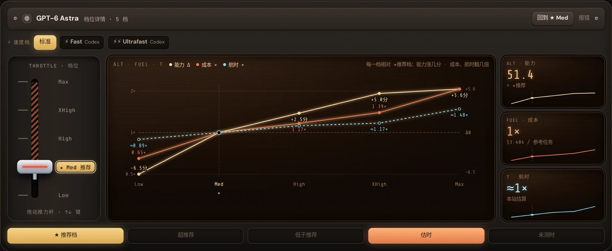
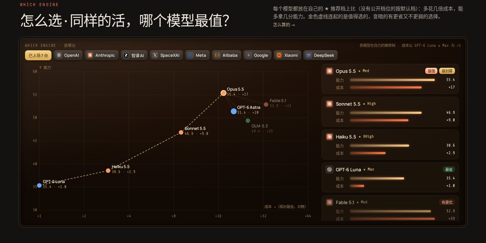
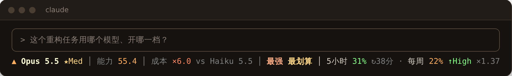
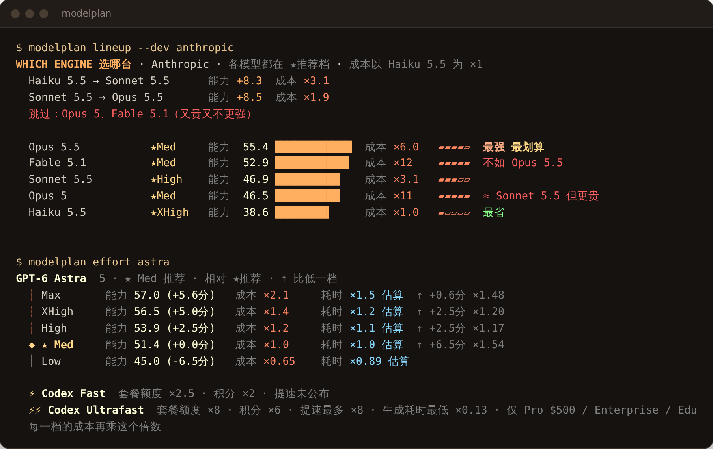
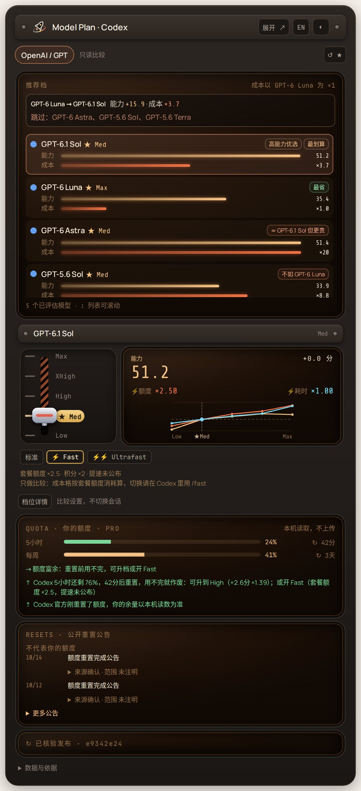
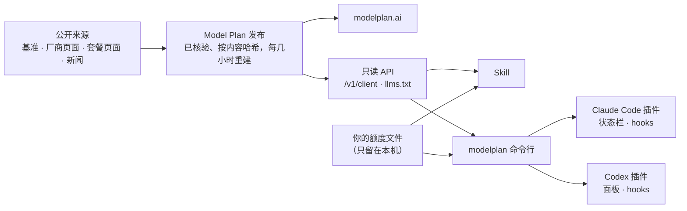

<div align="center">

<a href="https://modelplan.ai/?lang=zh"></a>

**写代码用哪个 AI 模型、开哪一档推理、再往上推一档值不值？**<br>
Model Plan 用实时、可复核的公开数据回答，网页上能看，在 Claude Code、Codex 和终端里也能直接用。

[](https://github.com/modelplan/modelplan/releases)
[](https://github.com/modelplan/modelplan/actions/workflows/ci.yml)
[](LICENSE)
[](data/)
[](https://modelplan.ai/?lang=zh)
[](https://github.com/modelplan/modelplan/stargazers)

[网站](https://modelplan.ai/?lang=zh) · [快速开始](#快速开始) · [截图](#能做什么) · [工作原理](#工作原理) · [常见问题](#常见问题) · [方法与来源](METHODOLOGY.zh-CN.md) · [English](README.md)

</div>

## 为什么用 Model Plan

大多数榜单只比各模型的**最高档**。但同一个模型从 Low 推到 Max，成本和耗时往往翻好几倍，能力只多几分。你真正在用的，是「某个模型的某一档」。

- **★ 推荐档：** 给每个模型算出最值的档位，并且明确告诉你再升一档能多拿几分（`+4.8`）、要多花几倍（`×1.37`）。
- **推荐档下的榜单：** 每个模型都按自己的 ★ 推荐档上榜，也就是你实际会用的配置；能力旁边同时列出单个参考编程任务的成本和耗时，被超越的模型（更贵又不更强）会直接标出来；你正好在用这样的模型时，命令行会提醒一次该换哪个：Fable 5.1 → Opus 5.5（能力 +2.5 分，成本 ×0.52），GPT-6 Astra → GPT-6.1 Sol（能力相当，成本 ×0.18）。
- **结合你的额度：** Skill 和命令行读取本机 Claude Code、Codex 的 5 小时和每周额度（只在本机读，不上传）。命令行还会只读打开 ZCode 和 OpenCode（V2）的本地数据库，按天、会话和项目统计 token。命令行还会在本机记下每个额度周期用到多少、花在哪个模型和档位上（`modelplan history`），以后据此按你自己的使用情况建议默认档位；还会实测你自己在各模型、档位和 Fast 下的速度：输出 tok/s、首字延迟、每轮耗时和 token，并和 ★ 推荐档对比（`modelplan effort`、`modelplan history` 查看；只读日志里的时间戳和 token 数）。快重置还剩很多？升一档，或开 Codex Fast。额度紧，或最近用得猛、3 小时内就会用完？守住 ★ 或降一档，并告诉你大约多久用完。重置之后，提醒你一次换回之前用的模型和档位（Codex 开了 Fast 也会提醒关掉）。

- **Gemini CLI 本机用量（可选）：** `modelplan usage gemini enable` 启用只读统计 Gemini 自己的本机聊天历史，按模型、日期和会话显示 token。用 `modelplan usage gemini` 查看，`disable` 关闭。不读取凭据或远程额度，不访问任何主机；缺失计数显示为 `--`。

- **其他套餐（可选）：** `modelplan connect zai` 用你放在 `Z_AI_API_KEY` 里的 API key 原生读取 Z.ai / GLM Coding Plan 的用量（国内站加 `--region bigmodel-cn`），`modelplan connect opencodego` 用 `OPENCODE_API_KEY` 读取 OpenCode Go，`modelplan connect kiro` 通过 Kiro 自己的命令行读取（`kiro-cli acp`，不发送任何提问，登录由 Kiro 保管）。key 只发给对应厂商的用量接口，不会保存；`modelplan connections` 显示每个套餐由哪个读取器负责。其余的用 `modelplan codexbar enable cursor zai` 通过开源的 [CodexBar](https://github.com/steipete/CodexBar) 命令行读取 Copilot、Cursor、Z.ai / GLM、Kiro、OpenCode Go 的用量，按锁定版本下载并校验（仅 macOS 和 Linux）。登录和 key 由 CodexBar 保管，本客户端只留百分比和重置时间。用 `modelplan declare zhipu-global-pro legacy-v2` 说明是哪个套餐在付费，建议就按它的计量方式给：按次计的套餐不会建议降档，而是提示下一个低倍率时段。

`modelplan connect minimax` 显式启用套餐额度，用 `MINIMAX_CODING_API_KEY` 或 `--key-env NAME` 供给 key，`--region international`（默认）或 `china` 选择地区。只调用所选地区，不保存 key，不支持的额度保持未知。[接口与隐私](docs/minimax-quota.md)。

`modelplan connect copilot` 可选启用已登录的 Copilot 运行时，通过 `account.getQuota` 读取每月高级请求用量，不创建会话、不导入 token。`modelplan disconnect copilot` 关闭读取。运行时缺失或不兼容时，可显式选择现有桥接：`modelplan connect copilot --backend codexbar`，登录仍由 CodexBar 保管。`modelplan connections` 显示运行时命令、主机边界和凭据处理方式。
- **套餐与时段：** 按厂商、模型、价位比较 Coding 套餐的价格和额度；优惠时段、高峰时段和官方额度重置放在周历上。
- **在你的工具里：** 一个开源 Skill 适配各种 Agent，另有 Claude Code 和 Codex 插件、单文件命令行，和网站读同一份已核验的公开数据。

## 快速开始

**Skill**：Claude Code、Codex、Cline、Amp 等 20 多个 Agent 都能用：

```sh
npx skills add modelplan/modelplan
```

然后问你的 Agent：「这个重构任务用哪个模型、开哪一档？」或者「我的 5 小时额度 40 分钟后重置，要不要升档？」

<details>
<summary><b>Claude Code 插件</b>：Skill、<code>/modelplan:*</code> 命令和状态栏</summary>

```text
/plugin marketplace add modelplan/modelplan
/plugin install modelplan@modelplan
```

插件会在后台自动下载配套的 `modelplan` CLI（锁定版本、核对校验值），不需要另外安装或升级；`/modelplan:setup` 可逐项检查。命令：`/modelplan:plan`、`/modelplan:effort`、`/modelplan:lineup`，以及 `/modelplan:statusline`（添加状态栏，改设置前会先问你）。[详情](claude-code/)

</details>

<details>
<summary><b>Codex 插件</b>：Skill 加 GPT 档位面板</summary>

```sh
codex plugin marketplace add modelplan/modelplan --sparse .agents --sparse codex
codex plugin add modelplan-codex@modelplan
```

对 Codex 说「打开 Model Plan 看板」。需要 Node.js 22+，Codex 自带时会自动使用。安装检查、可选 CLI 与卸载：[详情](codex/README.zh-CN.md)

</details>

<details>
<summary><b>modelplan 命令行</b>：macOS、Linux、Windows 单个静态可执行文件</summary>

```sh
curl -fsSL https://raw.githubusercontent.com/modelplan/modelplan/main/install.sh | sh
modelplan lineup --dev anthropic --lang zh
```

Windows 从 [Releases](https://github.com/modelplan/modelplan/releases) 下载；用 Go：`go install github.com/modelplan/modelplan/cli/cmd/modelplan@latest`。装了它 Skill 和插件会更快，没装也能用。[详情](cli/)

</details>

<details>
<summary><b>手动安装 Skill</b></summary>

把 [`skills/model-plan`](skills/model-plan/) 复制到 `~/.claude/skills/model-plan` 或你所用 Agent 的 skills 目录。只需要 shell 和匿名 HTTPS。

</details>

## 能做什么

### ★ 最值的档位，以及再升一档的代价

推动推力杆，看每个原生档位的能力、成本和耗时；打开 ⚡ Fast 或 ⚡⚡ Ultrafast，看套餐额度和耗时怎么变。



### 推荐档下的模型榜单




### 懂你额度的建议，就在 Claude Code 和 Codex 里

<table>
<tr>
<td width="56%" valign="top">

**Claude Code 状态栏**：实时显示模型和档位、5 小时与每周用量、重置倒计时；值得动手时给出提示（快重置还有余量时 `↑High ×1.37`，额度紧时 `↓`，重置后 `↺★`）。



**命令行**：阵容、档位阶梯、额度和建议。



</td>
<td width="44%" valign="top">

**Codex 面板**：GPT 模型按 ★ 推荐档比较、带 ⚡ 开关的档位曲线、你的 Codex 额度和官方重置公告。



</td>
</tr>
</table>

### Coding 套餐、优惠时段和额度重置


## 不只是另一个榜单

| | 常见榜单 | Model Plan |
| --- | --- | --- |
| 比较的配置 | 各模型最高档 | 各模型的 ★ 推荐档，外加其他每一档 |
| 成本 | 每百万 token 单价 | 每一档完成一个参考编程任务的成本 |
| 耗时 | 很少有 | 每一档的任务耗时（估算会标出） |
| 再升一档 | 不显示 | 每一步的 `+能力` 和 `×成本` |
| 你的额度 | 无 | 本机 Claude Code、Codex 额度，不上传 |
| 套餐 | 无 | 价格、额度、优惠时段和重置 |
| 在哪用 | 网页 | 网页、API、Skill、命令行、Claude Code、Codex |

## 工作原理



所有客户端只读取 Model Plan 已核验的公开发布，以及你的工具本来就写在本机的额度文件。排名、结论和倍数都来自发布数据，客户端从不自己排名。公式与来源见 [METHODOLOGY.zh-CN.md](METHODOLOGY.zh-CN.md)。

**原则：** 开源（MIT）· 只读 · 匿名、无账号、无遥测 · 额度只在本机读取 · 从不替你切换模型或档位。

## 常见问题

<details>
<summary><b>★ 推荐档是什么？</b></summary>

每个模型在原生档位（Low、Medium、High、XHigh、Max……）里，能力、成本和耗时最均衡的那一档。更高的档位会标出多拿几分、多花几倍，由你决定什么任务值得用。详见[方法与来源](METHODOLOGY.zh-CN.md)。

</details>

<details>
<summary><b>★ 为什么不是最高档，也不是厂商默认档？</b></summary>

按设计如此。★ 是同一模型各档里最值的一档，最高档始终列在旁边，网站也能把所有模型切到最高档比较。便宜模型常常推荐更高档，因为升一档只多几美分，而贵模型要多几美元。厂商默认档还考虑响应速度和限流，所以只显示在 ★ 旁边作参照，不照搬。能力分是冻结刻度（50 分是 2026 年 9 月前沿配置的平均水平），可以低于 0，也可以高于 100。

</details>

<details>
<summary><b>数据从哪来？多新？</b></summary>

能力分来自公开基准（如 Artificial Analysis），换算到统一口径；成本是按官方 API 价格完成一个参考编程任务的花费；耗时来自公开任务计时，缺失时估算并标注。套餐来自官方页面。每几小时生成并核验一次新发布，网站和每个客户端都会显示发布时间。

</details>

<details>
<summary><b>会上传我的任何信息吗？</b></summary>

不会。客户端匿名下载公开数据；Claude Code 和 Codex 的额度从本机文件读取，只在本机使用。命令行自己的记录也只留在本机：额度历史、实测速度、最长一年的每日 token，以及桌面端用来称呼项目的文件夹名（默认开启）。这些都不同步、不上传。`modelplan project-labels off` 会隐藏文件夹名并删除已记下的名称；`MODELPLAN_HISTORY=off` 停止记录。没有账号，没有遥测。

</details>

<details>
<summary><b>会替我切换模型或档位吗？</b></summary>

从不。它只给建议，切换由你决定。额度提示只显示给你，不发给 Agent；Agent 每个会话只收一份简短的任务开始简报，除非当前设置明显不适合这个任务，否则不提模型和档位。

</details>

<details>
<summary><b>覆盖哪些模型和套餐？</b></summary>

OpenAI、Anthropic、Google、xAI、智谱、Kimi、小米、MiniMax、Meta、阿里、DeepSeek、腾讯等厂商的现役编程模型及其 Coding 套餐。实时列表见 [modelplan.ai](https://modelplan.ai/?lang=zh) 和 [`/v1/client`](https://modelplan.ai/v1/client)。

</details>

<details>
<summary><b>我能在自己的工具或 Agent 里用这些数据吗？</b></summary>

可以：只读 API 免 key（[OpenAPI](https://modelplan.ai/openapi.json)），Agent 可以从 [llms.txt](https://modelplan.ai/llms.txt) 开始，优惠时段和重置日历可订阅 [ICS](https://modelplan.ai/calendar.ics)。

</details>

## 仓库结构

| | 目录 | 说明 |
| --- | --- | --- |
| **Model Plan Skill** | [`skills/model-plan/`](skills/model-plan/) | 主角，适用任何支持 Skill 的 Agent：选模型和档位、每升一档的倍数、按剩余额度和重置时间规划 |
| Claude Code 插件 | [`claude-code/`](claude-code/) | Skill、`/modelplan:*` 命令、状态栏，以及一个 prompt hook：新提示只显示给你，Claude 每个会话只收一份简短的任务开始简报 |
| Codex 插件 | [`codex/`](codex/) | Skill 和 GPT 档位面板：⚡ Fast / Ultrafast 开关、你的 Codex 额度、官方重置公告 |
| 桌面版（预览） | [`desktop/`](desktop/) | macOS 菜单栏应用：菜单栏显示剩余额度和当前提示，弹窗里看会话、额度和档位曲线，每条提醒只通知一次。目前是未签名的测试构建 |
| `modelplan` 命令行 | [`cli/`](cli/) | 单个静态可执行文件：`lineup`、`effort`、`models`、`quota`、`advise`、`statusline`、`sync`、`doctor` |
| 开放数据 | [`data/`](data/) | 网站背后经过审核的数据：套餐档位、价格、额度计量、日历、模型身份和档位策略。每次变化从 modelplan.ai 同步过来，一次一个 PR |
| 方法与来源 | [`METHODOLOGY.zh-CN.md`](METHODOLOGY.zh-CN.md) | 能力、成本、耗时和 ★ 推荐档怎么算，以及数据源 |

## 参与贡献

发现价格、额度、档位或新闻有误？[报告数据问题](https://github.com/modelplan/modelplan/issues/new?template=data-problem.yml)；modelplan.ai 上的「报错」链接会自动填好页面和条目。欢迎提 bug、想法和 PR，见 [CONTRIBUTING.md](CONTRIBUTING.md)；版本记录见 [CHANGELOG.md](CHANGELOG.md)。

如果 Model Plan 帮你省了额度或钱，点个 ⭐ 能让更多人看到它。

[](https://star-history.com/#modelplan/modelplan&Date)

## 许可

代码：[MIT](LICENSE)。[`data/`](data/) 和 API 的数据：[per-file data licenses](data/LICENSE)，注明 Model Plan 即可；第三方数据沿用其来源条款。[`desktop/official-visuals/`](desktop/official-visuals/) 里的官方桌面视觉另有[保留许可](desktop/official-visuals/LICENSE.md)，不是 MIT；品牌也另有规定，见[许可说明](LICENSING.md)。Model Plan 是独立项目，与任何模型厂商无关；厂商名称与商标归各自所有者。
